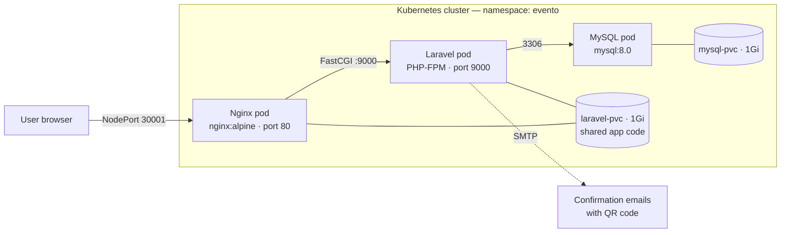
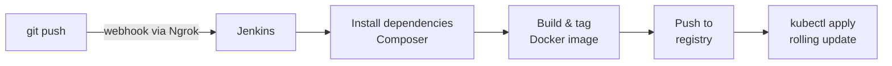

# Evento — Event Management Platform on Kubernetes with CI/CD

Evento is a web platform for publishing and booking events (conferences, workshops, seminars, webinars). It was built and deployed during a DevOps internship at **Phylia Technology** (August 2025), covering the full path from application code to a cloud deployment:

**Laravel app → Docker image → Kubernetes (Minikube) → Jenkins CI/CD → K3s on Azure**

---

## Table of contents

- [Features](#features)
- [Tech stack](#tech-stack)
- [Architecture](#architecture)
- [Kubernetes resources](#kubernetes-resources)
- [CI/CD pipeline](#cicd-pipeline)
- [Cloud deployment (Azure)](#cloud-deployment-azure)
- [Issues encountered and fixes](#issues-encountered-and-fixes)
- [Running locally](#running-locally)
- [Project status](#project-status)

---

## Features

The platform serves three roles, each with its own dashboard.

| Role | Capabilities |
|---|---|
| **Administrator** | Manage users (organizers, participants) and event categories (CRUD) |
| **Organizer** | Create, edit and delete events; review booking requests and accept or reject them |
| **Participant** | Browse and filter events, request a booking, manage favorites, view booking history and notifications |

When an organizer accepts a booking, the platform generates a **unique QR code** for the participant (event title, date, venue, participant identity) and sends it in a **confirmation email**.

## Tech stack

| Layer | Technologies |
|---|---|
| Application | PHP 8.2, Laravel 12 (MVC), Blade, Laravel Breeze (authentication), simple-qrcode |
| Database | MySQL 8.0 |
| Web server | Nginx (reverse proxy to PHP-FPM) |
| Containers | Docker |
| Orchestration | Kubernetes — Minikube (local), K3s (Azure) |
| CI/CD | Jenkins (Groovy pipeline), GitHub webhook exposed via Ngrok |
| Cloud | Microsoft Azure (Ubuntu 22.04 VM, Standard B2s) |

## Architecture



- **Nginx** serves static files from `public/` and forwards PHP requests over FastCGI to the Laravel service.
- **Laravel (PHP-FPM)** runs the application. An **init container** copies the application code into a shared volume and sets file permissions, so Nginx and PHP-FPM read the same code.
- **MySQL** stores users, events, categories, reservations, favorites and notifications on a persistent volume.

## Kubernetes resources

| Kind | Name | Purpose |
|---|---|---|
| Namespace | `evento` | Isolates all project resources |
| Deployment | `mysql`, `laravel`, `nginx` | One deployment per tier |
| Service | `mysql` (ClusterIP :3306) | Internal database access |
| Service | `laravel-service` (:9000) | FastCGI target for Nginx |
| Service | `nginx-service` (NodePort 30001 → 80) | External entry point |
| ConfigMap | `laravel-env` | Laravel `.env` configuration |
| ConfigMap | `nginx-config` | Nginx `default.conf` (FastCGI, static file caching) |
| Secret | `mysql-secret` | Database credentials |
| PersistentVolumeClaim | `mysql-pvc`, `laravel-pvc` (1Gi each) | Database data and shared application code |

Deployment order: configuration (ConfigMaps, Secret, PVCs) → MySQL → Laravel → Nginx → Services → verification with `kubectl get pods,svc -n evento`.

## CI/CD pipeline

Jenkins ran in a Docker container on the same Ubuntu VM as the cluster. Ngrok exposed it through a public HTTPS URL, which a GitHub webhook called on every push.



| Stage | What it does |
|---|---|
| Checkout | Pulls the latest commit from GitHub |
| Dependencies | `composer install` for the Laravel backend |
| Build & tag | Builds the PHP-FPM image from the `Dockerfile` with a versioned tag |
| Push | Pushes the image to the container registry |
| Deploy | Applies the Kubernetes manifests so the cluster runs the new version |

Every code change therefore produced a new versioned image and a deployment, with no manual steps.

## Cloud deployment (Azure)

| Item | Configuration |
|---|---|
| VM | Ubuntu 22.04 LTS, Standard B2s (2 vCPU, 4 GB RAM), 64 GB SSD |
| Open ports | 22 (SSH), 80/443 (Nginx), 8080 (Jenkins) |
| Kubernetes | K3s, single node |
| Exposure | Nginx via NodePort on the VM public IP |

```bash
sudo apt update && sudo apt upgrade -y
curl -sfL https://get.k3s.io | sh -
sudo k3s kubectl get nodes
```

The Minikube manifests were adapted for the cloud environment (NodePort exposure, persistent volumes for MySQL) and applied to the K3s cluster.

## Issues encountered and fixes

| Problem | Root cause | Fix |
|---|---|---|
| Nginx failed to start | Port 80 already in use on the node | Changed the Nginx port in the manifests |
| Laravel could not write to storage | Wrong ownership on the persistent volume | Set permissions in the init container |
| Laravel → MySQL connection refused | Mismatch between the Secret and Laravel environment variables | Aligned `mysql-secret` with `laravel-env` |

## Running locally

```bash
git clone https://github.com/Mabrouka-Messaoudi/Evento.git
cd Evento
cp .env.example .env          # set DB_* and MAIL_* values
composer install
npm install && npm run build
php artisan key:generate
php artisan migrate
php artisan serve
```

Build the container image:

```bash
docker build -t evento:latest .
```

## Project status

The application was deployed and reachable online on Azure, with the Jenkins pipeline running end-to-end. The Azure VM has since been decommissioned at the end of the internship, so the live deployment, the Kubernetes manifests and the Jenkinsfile are no longer available. This repository contains the application source code and the `Dockerfile`. The infrastructure is documented above as it was deployed.
